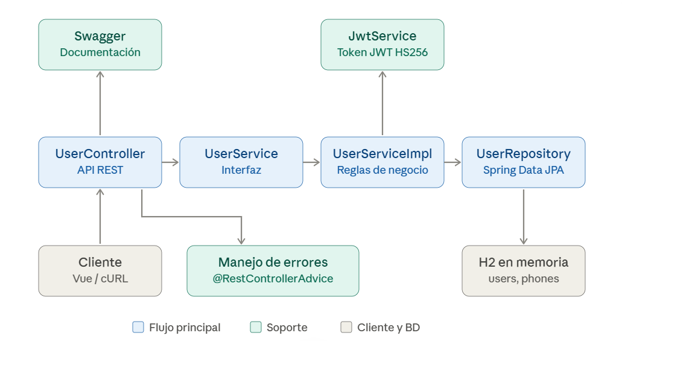

# API de registro de usuarios

Backend **Spring Boot 3 / Java 17 / Maven / JPA (Hibernate) / H2 en memoria** y frontend **Vue 3 (Composition API)**.

## Estructura

```
backend/   API REST (controller -> service -> serviceImpl -> repository)
frontend/  Formulario de registro en Vue 3 + Vite
db/        schema.sql (script de creación de BD; también se ejecuta al arrancar)
```

## Requisitos previos
- JDK 17+ y Maven 3.8+
- Node.js 18+ (solo para el frontend)

## Ejecutar el backend
```bash
cd backend
mvn spring-boot:run
```
- API: http://localhost:8080
- Swagger UI: http://localhost:8080/swagger-ui.html (contrato OpenAPI en `/v3/api-docs`)
- Consola H2: http://localhost:8080/h2-console (JDBC URL `jdbc:h2:mem:testdb`, usuario `sa`, contraseña vacía)

## Pruebas
```bash
cd backend
mvn test
```
- `UserServiceImplTest`: reglas de negocio con Mockito (éxito, correo inválido, contraseña inválida, duplicado).
- `JwtServiceImplTest`: generación, lectura, firma distinta y expiración del JWT.
- `UserRegistrationIntegrationTest`: flujo HTTP completo con H2 (201, 400, 409 y formato `{"mensaje": ...}`).

## Ejecutar el frontend
```bash
cd frontend
npm install
npm run dev
```
Abrir http://localhost:5173 (Vite redirige `/api` al backend en el puerto 8080).

## Probar con cURL
```bash
curl -X POST http://localhost:8080/api/users/register \
  -H "Content-Type: application/json" \
  -d '{"name":"Juan Rodriguez","email":"juan@rodriguez.org","password":"hunter2",
       "phones":[{"number":"1234567","citycode":"1","contrycode":"57"}]}'
```
Respuesta `201 Created`:
```json
{
  "id": "7d1c3b0e-...", "name": "Juan Rodriguez", "email": "juan@rodriguez.org",
  "phones": [{"number":"1234567","citycode":"1","contrycode":"57"}],
  "created": "2026-10-28T10:00:00", "modified": "2026-10-28T10:00:00",
  "last_login": "2026-10-28T10:00:00", "token": "eyJhbGciOiJIUzI1NiJ9.…", "isactive": true
}
```

## Errores (siempre `{"mensaje": "..."}`)
| Caso | HTTP |
|------|------|
| Correo con formato inválido | 400 |
| Contraseña no cumple la regex | 400 |
| Campos obligatorios faltantes / JSON inválido | 400 |
| `El correo ya registrado` | 409 |
| Error inesperado | 500 |

## Configuración
En `backend/src/main/resources/application.properties`:
- `app.security.password-regex`: regex configurable de la contraseña (por defecto 3–12 caracteres, con mayúscula, minúscula y número).
- `app.validation.email-regex`: regex del correo (ej. `aaaaaaa@dominio.cl`).
- `app.jwt.secret`: secreto HS256 (mínimo 32 caracteres). Se puede sobrescribir con la variable de entorno `JWT_SECRET`.
- `app.jwt.expiration-minutes`: vigencia del JWT (por defecto 60).

## Diagrama de la solución


## Decisiones
- La contraseña se guarda con BCrypt y nunca se devuelve en la respuesta.
- El token es un **JWT firmado (HS256, jjwt)** con subject = correo y expiración configurable; se persiste junto al usuario.
- El esquema lo crea `schema.sql` (`ddl-auto=none`).
